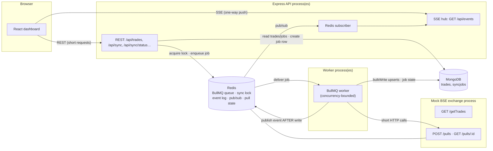
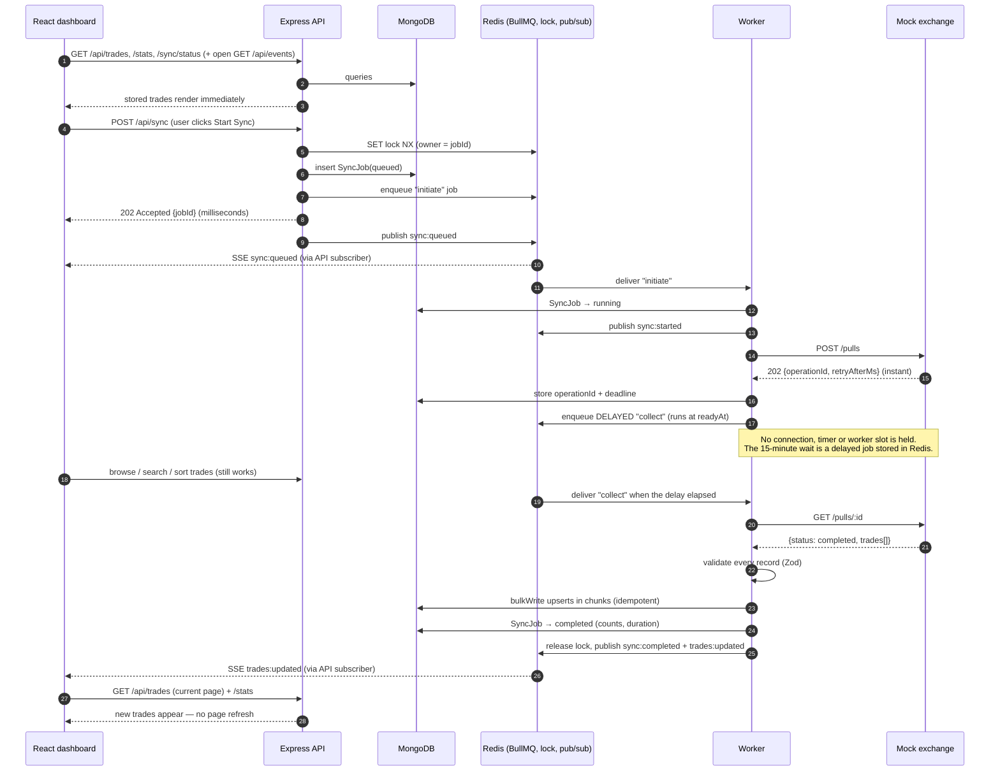

# TradeSync – Architecture note

**Problem.** A full pull from the BSE API takes up to 15 minutes. Our network kills any HTTP connection held open longer than 30 seconds. The dashboard must open instantly, show what is already stored even mid-pull, and update itself when a pull finishes – with no refresh, no polling loop, no cron.

**Core idea.** Decouple *accepting* a request, *doing* the work, and *telling the browser*. Every HTTP exchange in the system lasts milliseconds; the 15 minutes live in a Redis-backed delayed job, never in a socket.

> Legend: everything below describes **implemented behaviour** unless a section is explicitly labelled *Recommendation*.

## 1. Components

Redis is the shared nervous system: the **queue** (BullMQ), the **single-sync lock**, the **event bus** (pub/sub + short replay log) and the exchange's operation state. MongoDB is the source of truth for trades and job history.

## 2. Sequence: one synchronization

If the exchange answers `pending` at collect time (e.g. it was slower than it announced), the worker schedules another delayed `collect` using the exchange's own `retryAfterMs` (clamped to 1 s–5 min) – bounded, backoff-style rescheduling, never a tight loop – until the operation's deadline (`EXCHANGE_OPERATION_TIMEOUT_MS`).

## 3. Design rationale

**Why no HTTP request lasts 15 minutes.** The network drops connections after 30 s. Any design where a browser, API, or worker holds a single request open for the pull is broken by construction. Here: `POST /api/sync` = lock + one insert + one enqueue (tens of ms); worker→exchange calls are separate short requests with a hard timeout (`EXCHANGE_HTTP_TIMEOUT_MS`, validated `< 30 s`); browser data calls are short REST reads.

**Why background processing.** The pull outlives any request and any browser tab. Running it in a worker means closing the tab, restarting the API, or deploying new API code doesn't affect it, and the work can be retried independently of the user.

**Why Redis + BullMQ.** Jobs are persisted in Redis (not process memory), so queued work survives API restarts and is re-delivered if a worker dies mid-job (stalled-job detection). BullMQ gives retries with exponential backoff, bounded concurrency, delayed jobs (the mechanism that implements the wait), and de-duplication by custom job IDs. Redis also hosts the lock and pub/sub, so there is a single extra infrastructure dependency.

**Why SSE.** The browser only needs one-way, server→client notifications. SSE is plain HTTP, has built-in reconnection and `Last-Event-ID` in the browser's `EventSource`, passes proxies more easily than WebSockets, and needs no client library. Events are tiny (job state, counts); trade rows are never pushed – the dashboard re-fetches via REST.

**Why polling is unnecessary.** Completion is *pushed*: worker → Redis pub/sub → API → SSE → browser. The client has no `setInterval`, no recurring `fetch`, no refetch interval. Every request is caused by a user action, an event, or a reconnection. Server side there is no cron either: the only waiting is BullMQ delayed jobs (event-driven by Redis).

**Persistence and idempotency.** Each trade is upserted by unique `tradeId` using unordered `bulkWrite` in chunks, so retries, duplicate deliveries and re-syncs can never create duplicates (verified by tests). The whole payload is validated *before* the first write; a malformed ratio above `MAX_INVALID_RATIO` fails the job with nothing written. Prices are integer paise so aggregations are exact. A job becomes `completed` with a single atomic update **after** every chunk succeeded; the lock is released and events are published only after that. A failed write therefore never yields `completed` (verified by tests).

**Worker ↔ API communication.** They are separate processes, so an in-memory emitter would not work. The worker `PUBLISH`es to a Redis channel (and appends to a 200-entry event log for replay); every API instance subscribes and fans out to its own SSE clients. Multiple API instances and multiple workers work unchanged.

**Single active sync.** `POST /api/sync` does `SET lock:sync <jobId> NX PX <ttl>`. Losers get **409** naming the active job. Release is a Lua compare-and-delete, so a job can never delete a lock now owned by another job. The TTL (`timeout + 5 min`) is the self-healing path if every process dies.

## 4. Failure behaviour

| Scenario | What happens |
|---|---|
| **Browser closes mid-pull** | Nothing – the job doesn't depend on any client. Reopening shows stored trades and the active job immediately. |
| **Dashboard opens during a pull** | Initial REST calls return stored data + `active` job; SSE then delivers progress/completion. |
| **SSE connection drops** | `EventSource` reconnects (with backoff if it gives up). Server replays events after `Last-Event-ID` from the Redis log; the dashboard also re-fetches stats/trades/sync state on every reconnect. No polling involved. |
| **API restarts** | In-flight HTTP/SSE end; browsers reconnect. Queue, jobs and lock live in Redis/Mongo, so the sync continues in the worker. |
| **Worker crashes mid-job** | BullMQ marks the job stalled and re-delivers it to another/restarted worker. Steps are idempotent (an existing exchange operation is reused; upserts don't duplicate). Retries use exponential backoff up to `JOB_ATTEMPTS`; then the job is `failed` and the lock freed. |
| **Worker gets SIGTERM** | `worker.close()` finishes in-flight jobs before exit (30 s hard cap); the rest are re-delivered. |
| **Exchange down / HTTP error** | Retryable `ExchangeError` → BullMQ retries with backoff, then `failed`. A 404 for the operation or an exchange-reported failure fails immediately (not retryable). |
| **Malformed exchange data** | Validation rejects the job before any write. |
| **Exchange exceeds its deadline** | Job fails with "exceeded its allowed deadline". |
| **MongoDB write fails** | Job retries; after the last attempt it's `failed`, never `completed`. |
| **MongoDB / Redis down at request time** | API answers **503** (Redis commands fail fast; they don't hang past 30 s). |
| **Redis pub/sub reconnects** | API broadcasts a `resync` event so dashboards re-read state. |
| **Queue entry lost (Redis flushed)** | On worker start `reconcileOrphanedJobs` fails active jobs that no longer have a queue entry and frees their lock. |
| **Invalid env / filters** | Process refuses to start with a clear list / API returns 400 with details. |

## 5. Guarantees that depend on deployment

- **Durability of queued work** = Redis persistence (AOF is enabled in the provided `docker-compose.yml`). A Redis that loses its data loses in-flight jobs; reconciliation then marks them failed so users can retry.
- **At-least-once delivery**: BullMQ may deliver a step twice; the steps are idempotent by design. Exactly-once is not claimed.
- **SSE through proxies**: heartbeats keep *idle-timeout* proxies from closing the stream; a *hard* per-request cap (e.g. exactly 30 s regardless of activity) would force reconnects every ~30 s – state stays correct thanks to replay + REST reconciliation, but this is the one place a long-lived connection exists. Configure the proxy to allow streaming (`X-Accel-Buffering: no` is already sent).
- **Event delivery** to browsers is best-effort (pub/sub); correctness never depends on it because REST reads are authoritative.
- **Multi-instance API/worker** relies on a shared Redis/MongoDB; the single-sync lock is a single-Redis-node lock (not Redlock).

## 6. Recommendations (not implemented)

Authentication and authorization; Redis Streams with consumer groups for events; a paginated/cursor-based exchange protocol (or streaming ingest) for datasets too large for worker memory; Mongo replica set with majority writes; metrics/tracing/alerting on stuck or failed jobs; a CI pipeline running the integration tests against real MongoDB and Redis; per-job heartbeats if the exchange later reports real progress.
